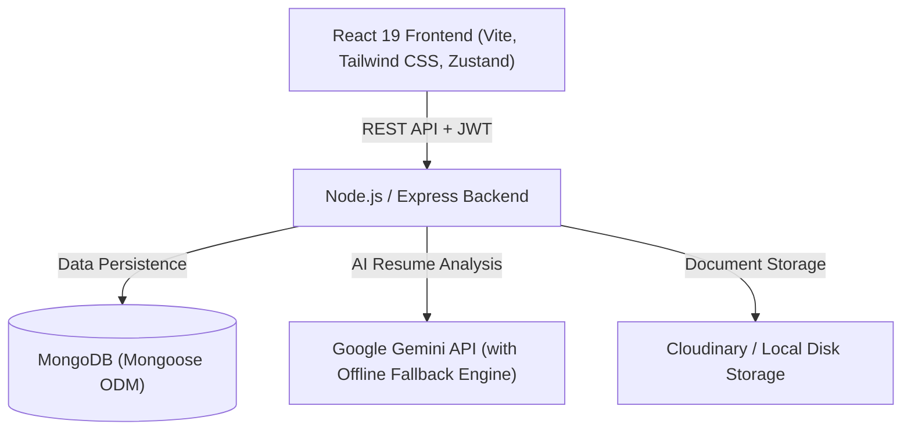

# 🚀 HireHub — Intelligent Job Portal & Automated Recruitment Platform

HireHub is a full-stack, AI-powered recruitment and job-matching platform designed to streamline hiring workflows for **Job Seekers**, **Employers**, and **Platform Administrators**. It incorporates automated resume parsing, ATS compatibility scoring, skills gap analysis, intelligent candidate ranking, and an interactive job recommendation engine.

---

## 🏗️ System Architecture



The system is organized into three primary tiers:
1. **Frontend Client (`Frontend/hirehub-frontend`)**: Built with React 19, Vite, Tailwind CSS, Lucide icons, and Zustand for state management.
2. **Backend API Server (`Backend/NodeBackend`)**: Built on Node.js and Express.js, implementing JWT authentication, role-based access control (RBAC), and RESTful endpoints.
3. **Database & Persistence (`DB/` & MongoDB)**: Scalable document-based data schema with indexed queries for fast searching, filtering, and application tracking.
4. **AI & Intelligence Engine**: Powered by Google Gemini with a high-accuracy, 500+ skill taxonomy offline heuristic backup engine (`aiFallbackEngine.js`).

---

## ✨ Key Features & Modules

### 1. 👤 Job Seeker Module
- **Profile Management**: Profile creation, contact info, education, skills, and certifications.
- **Resume Upload & ATS Parsing**: Automatic extraction of skills, experience, and target roles from PDF resumes.
- **Skill Gap Analysis**: Identifies missing competencies for target job roles with actionable career recommendations.
- **Smart Recommendations**: Ranked list of open positions scored by resume match percentage.
- **Application Tracking**: Real-time status updates (Applied, Reviewed, Shortlisted, Interview, Accepted, Rejected).

### 2. 🏢 Employer Module
- **Company Profile**: Brand setup, industry, location, description, and website.
- **Job Posting & Management**: Create, edit, close, and monitor listings with salary ranges, required skills, and experience levels.
- **Automated Applicant Ranking**: Candidates ranked by AI match scores against job requirements.
- **Interview Scheduling**: Schedule dates, times, interview types (online/in-person), meeting links, and feedback notes.

### 3. 🛡️ Admin Dashboard
- **Platform Analytics**: Total users, active jobs, applications, and system metrics.
- **User Management**: Monitor, activate, or deactivate job seekers and employer accounts.
- **Moderation & Flagging**: Review and flag inappropriate or suspicious job postings.

---

## 🛠️ Tech Stack

| Layer | Technologies |
| :--- | :--- |
| **Frontend** | React 19, Vite, Tailwind CSS, Zustand, Axios, React Router v7 |
| **Backend** | Node.js, Express.js, JSON Web Tokens (JWT), Multer, pdf-parse |
| **Database** | MongoDB, Mongoose ODM |
| **AI / NLP** | Google Gemini API, Offline Heuristic NLP Engine (`aiFallbackEngine.js`) |
| **File Storage** | Cloudinary API with local disk fallback storage |

---

## 📂 Project Structure

```
Hirehub/
├── Backend/
│   └── NodeBackend/
│       ├── src/
│       │   ├── config/          # Database and environment configurations
│       │   ├── controllers/     # Route business logic (auth, jobseeker, employer, jobs, admin)
│       │   ├── middleware/      # Auth, role-based access, error handling, upload
│       │   ├── models/          # Mongoose data schemas (User, Job, Application, Profile)
│       │   ├── routes/          # Express route definitions
│       │   ├── services/        # AI service, ranking, match score, fallback engine
│       │   └── utils/           # Helper utilities
│       ├── uploads/             # Local file storage
│       ├── .env.example         # Environment template
│       └── package.json
├── Frontend/
│   └── hirehub-frontend/
│       ├── src/
│       │   ├── api/             # Axios instance with interceptors
│       │   ├── components/      # UI components, layout, navbar, cards, stepper
│       │   ├── pages/           # Admin, Employer, JobSeeker, and Auth pages
│       │   ├── store/           # Zustand auth store
│       │   └── utils/           # Utility functions (URL, token handling)
│       ├── package.json
│       └── vite.config.js
├── DB/
│   ├── README.md                # Database documentation
│   └── seed_data.py             # Python database seeding script
└── docs/
    ├── Hirehub_High_Level_Design.png
    ├── HireHub_Implementation_Chapter.pdf
    └── HireHub_Mini_Project_Report.pdf
```

---

## 🚀 Quick Start & Installation

### Prerequisites
- [Node.js](https://nodejs.org/) (v18+)
- [MongoDB](https://www.mongodb.com/) (Local instance running on `localhost:27017` or MongoDB Atlas)

---

### 1. Backend Setup

```bash
cd Backend/NodeBackend

# Install dependencies
npm install

# Configure environment variables
cp .env.example .env
# Edit .env with your MongoDB URI, JWT secret, and optional Gemini/Cloudinary keys

# Seed initial test data (admin, employers, jobseekers, jobs)
node src/seed.js

# Start backend server (default: http://localhost:8000)
npm run dev
```

---

### 2. Frontend Setup

```bash
cd Frontend/hirehub-frontend

# Install dependencies
npm install

# Start Vite development server (default: http://localhost:5173)
npm run dev
```

---

## 🔒 Environment Variables

### Backend (`Backend/NodeBackend/.env`)
```ini
PORT=8000
MONGO_URI=mongodb://localhost:27017/hirehub
JWT_SECRET=your_jwt_secret_key
JWT_EXPIRES_IN=7d
FRONTEND_ORIGIN=http://localhost:5173
NODE_ENV=development

# Optional AI / Cloudinary (Has automatic offline fallbacks)
GEMINI_API_KEY=your_gemini_api_key
GEMINI_MODEL=gemini-flash-lite-latest
CLOUDINARY_CLOUD_NAME=
CLOUDINARY_API_KEY=
CLOUDINARY_API_SECRET=
```

### Frontend (`Frontend/hirehub-frontend/.env`)
```ini
VITE_API_URL=http://localhost:8000/api
```

---

## 📄 License
This project is developed for academic and educational purposes.
